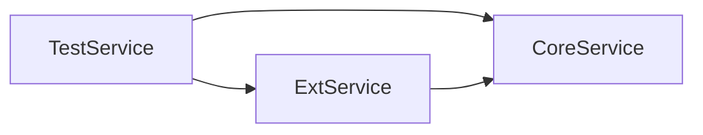

# Gradle

Two multi-module Gradle sample projects that show how to build, version and publish a small Java service stack with the Nebula plugins: `GradleBuildDemo` (a fixed version) and `GradleVersionDemo` (a version computed from Git).

## 🚀 Quick Start

Each project is self-contained and ships its own Gradle wrapper (Gradle 6.8, so use a JDK between 8 and 16: see **📋 Prerequisites & Dependencies**).

```bash
cd GradleBuildDemo

export JAVA_HOME=<path to a JDK 8-16>
./gradlew clean build
```

For prerequisites and project settings, see **📋 Prerequisites & Dependencies** and **⚙️ Build & Configuration** below.

### Usage

```bash
./gradlew clean build                       # compile and test every module
./gradlew :TestService:run                  # run TestServiceApp (the application plugin is applied there)
./runApp.sh                                 # GradleBuildDemo: clean build publishToMavenLocal
./buildGradle.sh                            # GradleVersionDemo: clean build snapshot publishToMavenLocal
```

### Output

| Result | Where |
| ------ | ----- |
| Module jars | `<module>/build/libs/` |
| Root project jar, source jar and javadoc jar (the Nebula plugins are applied to the root project only) | `build/libs/` |
| Published artifacts (`publishToMavenLocal`) | `~/.m2/repository/com/devamatre/buildtools/` |

## ✨ Features

- **Multi-module build** — `CoreService`, `ExtService` and `TestService`, wired together with project dependencies
- **Per-module build files** — `settings.gradle` names each module's script `<Module>.gradle` instead of `build.gradle`
- **Nebula plugins** — `nebula.release`, `nebula.maven-publish`, `nebula.javadoc-jar` and `nebula.source-jar`
- **Two versioning styles** — a fixed `1.0-SNAPSHOT` and a version inferred by `nebula.release`
- **Gradle wrapper** — Gradle 6.8, with no local Gradle install needed
- **JUnit 5 tests** — for each module's service classes

### Limits

The wrapper pins Gradle 6.8, which can't run on JDK 17 or newer. On JDK 21 the build stops while compiling `settings.gradle` with `Unsupported class file major version 65`.

## 📋 Prerequisites & Dependencies

- JDK 8 to 16 (Gradle 6.8 does not support newer JDKs)
- Git — `nebula.release` infers the version from the repository
- Network access to `services.gradle.org` (wrapper download) and Maven Central (plugins and dependencies)

| Source | Purpose |
| ------ | ------- |
| `build.gradle` | Plugins (`nebula.*`, versions `15.3.1` / `17.3.2`) and JUnit 5.7.0 — resolved on the first build |
| `gradle/wrapper/gradle-wrapper.properties` | Gradle 6.8 distribution, downloaded by `./gradlew` |

## ⚙️ Build & Configuration

### Build

```bash
cd GradleBuildDemo           # or GradleVersionDemo
./gradlew clean build
```

Where the build output lands: `<module>/build/` for each of `CoreService`, `ExtService` and `TestService`.

### Settings

| Setting | Where | What it does |
| ------- | ----- | ------------ |
| `rootProject.name` | `settings.gradle` | `GradleBuildDemo` or `GradleVersionDemo` |
| `include` | `settings.gradle` | Modules in the build: `CoreService`, `ExtService`, `TestService` |
| `buildFileName` | `settings.gradle` | Each module's script is `<Module>.gradle` |
| `group` | `build.gradle` | `com.devamatre.buildtools` |
| `version` | `GradleBuildDemo/build.gradle` | Fixed `1.0-SNAPSHOT` |
| `application { mainClass }` | `TestService/TestService.gradle` | `com.devamatre.buildtools.testservice.TestServiceApp` |

### Versioning

| Project | How the version is chosen |
| ------- | ------------------------- |
| `GradleBuildDemo` | `version '1.0-SNAPSHOT'` in `build.gradle`. |
| `GradleVersionDemo` | The version line is commented out, so `nebula.release` infers it. `./buildGradle.sh` runs the `snapshot` task. |

`GradleBuildDemo` also has a standalone `version.sh` that prints a version derived from `git describe` and `version.json`. `build.gradle` doesn't call it. `version.json` holds the settings the script reads:

| Key | Value | Meaning |
| --- | ----- | ------- |
| `defaultBranch` | `master` | Branch that gets a plain release version; other branches get the branch name appended |
| `major` | `1` | Next major version |
| `minor` | `0` | Next minor version |

If `version.json` is missing, `version.sh` creates it with `major` and `minor` set to `0`.

### Deploy

Both projects publish only to the local Maven repository (`publishToMavenLocal`) through `nebula.maven-publish`. There is no remote repository or CI workflow configured.

## 📁 Project Layout

```
Gradle/
├── GradleBuildDemo/                # Fixed-version demo
│   ├── CoreService/                # Core service classes
│   │   ├── CoreService.gradle      # Module build file
│   │   └── src/{main,test}/java/com/devamatre/buildtools/coreservice/
│   ├── ExtService/                 # Extension service (depends on CoreService)
│   │   ├── ExtService.gradle
│   │   └── src/{main,test}/java/com/devamatre/buildtools/extservice/
│   ├── TestService/                # Runnable app (depends on CoreService and ExtService)
│   │   ├── TestService.gradle
│   │   └── src/{main,test}/java/com/devamatre/buildtools/testservice/
│   ├── gradle/wrapper/             # Gradle 6.8 wrapper
│   ├── build.gradle                # Root build: plugins, group, version, JUnit 5
│   ├── settings.gradle             # Modules and per-module build file names
│   ├── runApp.sh                   # clean build publishToMavenLocal
│   ├── version.sh                  # Prints a Git-derived version
│   └── version.json                # Inputs for version.sh
├── GradleVersionDemo/              # Computed-version demo (same three modules)
│   ├── build.gradle                # Root build without a fixed version
│   ├── settings.gradle
│   └── buildGradle.sh              # clean build snapshot publishToMavenLocal
├── .gitignore                      # The .gitignore file
└── README.md                       ← you are here
```

The two projects share the same module names, packages and class names.

## 🏗️ Architecture



### Components

| ID | Component | Main classes |
| -- | --------- | ------------ |
| C1 | `CoreService` — the service abstractions | `Service`, `AbstractService`, `CoreService`, `ServiceManager`, `ServiceParams`, `ServiceType` |
| C2 | `ExtService` — an extension of the core service | `ExtService` |
| C3 | `TestService` — the runnable application | `TestService`, `TestServiceApp` |

## 🧪 Testing

```bash
./gradlew test
```

Test classes: `AbstractServiceTest` and `CoreServiceTest` (CoreService), `ExtServiceTest` (ExtService) and `TestServiceTest` (TestService). The root `build.gradle` and `TestService.gradle` configure JUnit 5.

## 🛠️ Troubleshooting

| Issue | Fix |
| ----- | --- |
| `Unsupported class file major version 65` (or any other version above 60) | Gradle 6.8 can't run on that JDK. Point `JAVA_HOME` at a JDK 8–16 |
| `./gradlew: Permission denied` | Run `sh ./gradlew …`, or `chmod +x gradlew` |
| `nebula.release` can't infer a version (`GradleVersionDemo`) | Run it from a Git repository |

### Known issues

- `GradleBuildDemo/settings.gradle` ends with `include 'CommonService'`, but there is no `CommonService` folder. Remove the line, or add the module.
- `CoreService.gradle` and `ExtService.gradle` have their `repositories`, JUnit 5 dependencies and `test { useJUnitPlatform() }` blocks commented out, and only the root build and `TestService.gradle` declare them. Check that the `CoreService` and `ExtService` tests run before relying on them.

## 📚 References

### In this repository

The two sub-projects have no README of their own; see **📁 Project Layout** above.

### External Documentation

| Link | Description |
| ---- | ----------- |
| [Gradle User Guide](https://docs.gradle.org/6.8/userguide/userguide.html) | Reference for Gradle 6.8, the wrapper version |
| [Gradle compatibility matrix](https://docs.gradle.org/current/userguide/compatibility.html) | Which JDK each Gradle version supports |
| [Nebula release plugin](https://github.com/nebula-plugins/nebula-release-plugin) | `nebula.release` version inference and the `snapshot` task |
| [Nebula plugins](https://github.com/nebula-plugins) | `maven-publish`, `javadoc-jar` and `source-jar` plugins |

## 📄 License

No license file is included in this folder.

## 👤 Author

- **Rohtash Lakra** — [@rslakra](https://github.com/rslakra)
